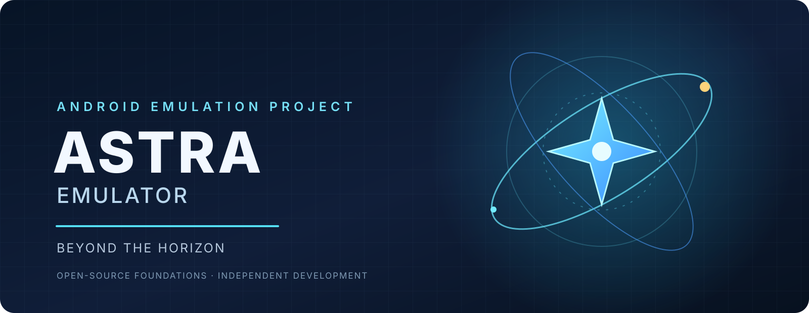

# ASTRA EMULATOR

**Explore more. Emulate thoughtfully.**

An experimental Android project for Nintendo Switch emulation, with a focus on device compatibility, graphics reliability, and performance research across ARM hardware.

[Source](https://github.com/suksesjt12-source/Astra-Emulator) · [Issues](https://github.com/suksesjt12-source/Astra-Emulator/issues) · [Development](ASTRA-PORTING.md)

---

## What is Astra?

Astra is an independent Android emulator development project. Its goal is to build and maintain an Android-focused experience while investigating compatibility and performance across a wider range of mobile hardware.

Astra's visual identity and project direction are maintained separately. The current codebase incorporates work from the open-source Nintendo Switch emulation ecosystem; Astra is not an official release of, or endorsed by, any upstream project.

## Project status

Experimental · Active development · Not a stable release

The repository is a work in progress. Source code and CI changes do not automatically mean that a feature is complete, that an APK is ready for daily use, or that a game is playable.

| Area | Current direction |
|---|---|
| Platform | Android |
| CPU architecture | ARM64 target |
| Graphics | Vulkan compatibility and driver diagnostics |
| GPU research | Adreno and ARM Mali compatibility investigations |
| Priorities | Correct rendering, stability, memory use, and frame pacing |
| Distribution | CI builds are for development and verification |

Hardware support is not guaranteed. Results can vary substantially with the Android version, system driver, GPU, memory pressure, and individual game.

## Astra principles

- **Compatibility before claims.** A device or feature is considered supported only after reproducible testing.
- **Stability before speed.** Avoid optimizations that trade correct rendering for unstable behavior.
- **Hardware-aware engineering.** Investigate GPU and driver behavior instead of assuming all Android devices behave alike.
- **Transparent progress.** Experimental work, known limitations, and build status should be clearly identified.
- **Respect for upstream work.** Preserve applicable licenses and attribution for code contributed by the wider emulation community.

## Building

Astra is an Android/NDK project. Build requirements and exact CI steps are defined by the repository workflow:

- [Android build workflow](.github/workflows/android-build.yml)
- [Porting and development notes](ASTRA-PORTING.md)

A successful compile verifies that the source can be built in that CI environment. It does **not** prove game compatibility or runtime stability on a physical device.

## Reporting issues

When reporting a problem, include:

1. Device model and Android version.
2. SoC and GPU model, if known.
3. Astra build/version and installation source.
4. Graphics driver and relevant emulator settings.
5. Game title and the exact point where the issue occurs.
6. A log or screenshot, with personal information removed.

Use the [issue tracker](https://github.com/suksesjt12-source/Astra-Emulator/issues). Do not upload copyrighted game files, console keys, firmware, or private account data.

## Legal and licensing

Astra does not include commercial game files, console encryption keys, or system firmware. Users are responsible for complying with the laws applicable to their use and for obtaining any required files from sources they are legally entitled to use.

This repository contains code from multiple open-source projects. See [LICENSE.txt](LICENSE.txt) and the relevant file-level notices for the applicable license terms and attribution. Astra-specific changes do not remove or replace upstream copyright notices.

## Acknowledgements

Astra builds on the work of the open-source emulation community, including the developers and contributors whose code and research made this project possible. Their licenses and notices remain part of this repository.

---

**ASTRA EMULATOR**  
*Independent direction. Open-source foundations.*

